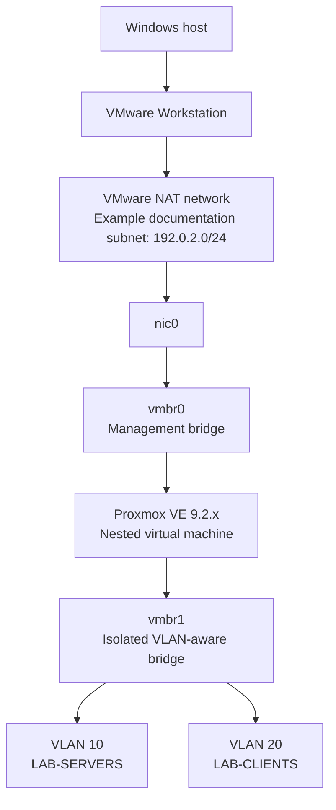

# Proxmox VE Homelab

A practical, continuously updated learning project documenting Proxmox VE administration in a nested virtualization lab. It covers host inspection, storage, virtual machines, Linux bridges, VLAN-aware networking, firewall concepts, backups, templates, Cloud-Init and troubleshooting.

> **Project status:** Learning lab / work in progress. This repository distinguishes between configurations actually performed, topics discussed, and exercises still pending. It is not a production deployment guide.

## Goals

- Understand Proxmox VE architecture and administration.
- Manage VM hardware and lifecycle from the CLI.
- Understand directory and LVM-thin storage.
- Build Linux bridges and segmented virtual networks.
- Learn Proxmox firewall scopes and safe rule design.
- Understand backup, retention, restore and snapshot workflows.
- Prepare reusable VM templates and Cloud-Init images.
- Record troubleshooting evidence and lessons learned.

## Lab topology

The Proxmox VE host runs as a VM inside VMware Workstation. The management bridge (`vmbr0`) connects to the VMware NAT-facing virtual NIC. A second bridge (`vmbr1`) is configured as an isolated, VLAN-aware lab bridge.



The addresses in the diagram and documentation are sanitized examples, not the original lab's live addressing.

## Repository layout

```text
.
├── README.md
├── .gitignore
├── docs/
│   ├── proxmox-learning-notes.md    <- environment, networking, storage, firewall, backup
│   ├── lxc-containers.md            <- LXC concept reference (12 topics)
│   ├── advanced-topics.md           <- nesting, namespaces, AppArmor, migration, API, Ansible
│   └── roadmap.md                   <- wider Proxmox VE study plan
├── labs/
│   ├── README.md                    <- lab index, conventions, evidence standard
│   ├── _lab-template.md             <- skeleton for a new lab
│   └── lxc/
│       ├── 01-understanding-lxc.md
│       ├── 02-downloading-templates.md
│       ├── 03-creating-first-container.md
│       ├── 04-privileged-vs-unprivileged.md
│       ├── 05-container-networking.md
│       ├── 06-container-storage.md
│       ├── 07-resource-management.md
│       ├── 08-container-backup-restore.md
│       ├── 09-container-security.md
│       └── 10-troubleshooting.md
├── commands/
│   └── cli-cheatsheet.md
├── diagrams/
│   └── README.md
└── evidence/
    ├── lxc/                         <- per-lab evidence (configs, output, screenshots)
    ├── screenshots/
    │   └── README.md
    └── configurations/
        └── README.md
```

## Learning status

### Completed / configured and observed
- Proxmox dashboard, node and host resource inspection.
- Storage inspection (`local`, `local-lvm`, LVM layout).
- Debian VM 100 creation and hardware configuration review.
- VM lifecycle and configuration commands.
- Creation and activation of isolated bridge `vmbr1`.
- VLAN-aware bridge configuration allowing VLAN IDs 10 and 20.
- Review of firewall, backup/restore and template workflows.

### Discussed, not yet validated end-to-end
- Proxmox firewall rule implementation and enforcement.
- Backup job scheduling, retention and restore.
- Cloud-Init template creation and cloning.
- VM-to-VM VLAN connectivity.

### Pending practical work
- Resolve nested KVM availability before starting guest VMs.
- Boot and install the Debian lab VM.
- Assign VM NICs to VLAN 10 and VLAN 20 and test traffic.
- Implement and validate firewall rules.
- Perform a backup/restore exercise.
- Build and test a Cloud-Init template.
- Work through the ten LXC labs in [`labs/lxc/`](labs/lxc/).
- Learn users, roles and ACLs (`pveum`).

See [`docs/proxmox-learning-notes.md`](docs/proxmox-learning-notes.md) for detailed notes and commands.

## Learning path

Everything here follows **Concept → Practical implementation → Evidence and
troubleshooting**, so each topic ends with proof rather than a summary.

| Stage | Read | Do | Record |
|---|---|---|---|
| Understand LXC | [`docs/lxc-containers.md`](docs/lxc-containers.md) | [`labs/lxc/01`–`02`](labs/lxc/) | [`evidence/lxc/`](evidence/lxc/) |
| Build containers | same | [`labs/lxc/03`–`04`](labs/lxc/) | same |
| Network and storage | same | [`labs/lxc/05`–`06`](labs/lxc/) | same |
| Resources and backup | same | [`labs/lxc/07`–`08`](labs/lxc/) | same |
| Security and troubleshooting | same | [`labs/lxc/09`–`10`](labs/lxc/) | same |
| Go further | [`docs/advanced-topics.md`](docs/advanced-topics.md) | — | — |
| Wider roadmap | [`docs/roadmap.md`](docs/roadmap.md) | — | — |

Lab status lives in the [lab index](labs/README.md). A lab is marked done only
after the steps were executed **and** evidence was captured — the documentation
being written is not the same as the work being done.

## Important lab constraints

- Proxmox is nested inside VMware Workstation; nested hardware virtualization is currently unavailable, so VM 100 could not start with KVM acceleration.
- The Proxmox VM has limited RAM and a 20 GB virtual disk. Check free space and memory before importing images or creating more guests.
- `vmbr0` is the management bridge. Do not change its address, gateway or physical bridge port without console access and a recovery plan.
- The `vmbr1` VLAN-aware bridge permits VLAN IDs 10 and 20, but VM NIC tagging and end-to-end connectivity still need to be configured and tested.

## Safety and publication notes

- All IP addresses and MAC addresses in the public documentation have been replaced with documentation/example values.
- Do not commit passwords, API tokens, SSH private keys, certificates, personal IPs, hostnames you do not want public, or unredacted screenshots.
- Review screenshots and configuration files before committing.
- Commands that modify networking, firewall policy, storage or VM disks can interrupt access or cause data loss. Read the notes and verify target IDs before execution.

## Suggested workflow

1. Read the lab environment and networking sections.
2. Review the command cheat sheet.
3. Reproduce one change at a time in a disposable lab.
4. Capture sanitized command output or screenshots as evidence.
5. Update the learning status only after verifying the result.

## Disclaimer

This repository is an educational record of a personal lab. Commands and examples must be checked against the installed Proxmox VE version and the target environment before use. It is not a substitute for official documentation or a tested production change plan.
